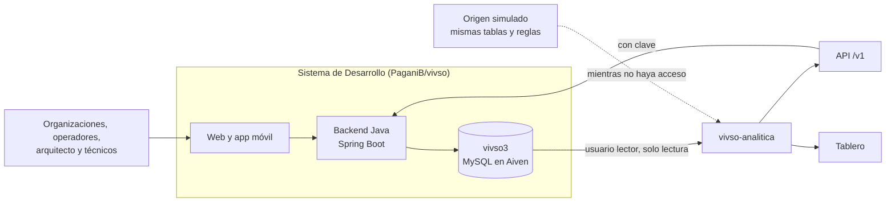
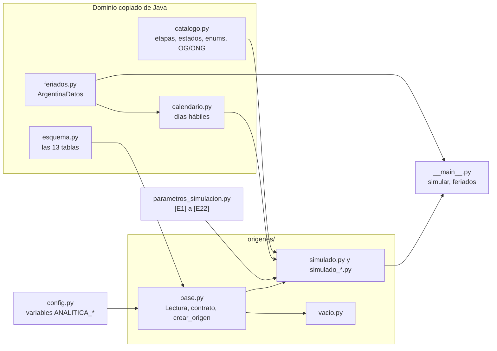

# vivso-analitica

Servicio de analítica de VIVSO (Grupo 8, ITSE, Práctica Profesionalizante III). Lee lo que carga el sistema de
Desarrollo —solicitudes, viviendas, etapas de obra y sus fotos, visitas, organizaciones y documentos—, conserva la
historia que ese sistema no guarda, calcula indicadores y los publica. Mientras no hay acceso a la base real, trabaja con
un origen simulado que reproduce las mismas tablas y reglas.



## Estado

**Hecho:** el dominio copiado del sistema de Desarrollo (etapas, estados, enums, días hábiles como Java y feriados de
ArgentinaDatos), el esquema de las 13 tablas con su contrato, el origen vacío, el origen simulado con las reglas de
Java, y los documentos sobre el sistema de Desarrollo y lo que le pedimos.

**Falta:** la sincronización que guarda la historia, la conexión a la base real (esperamos la contraseña y el
certificado del usuario de solo lectura), el AFO por etapas y los indicadores, la API, el tablero, el despliegue y los
documentos de evaluación, resultados, implementación y monitoreo.

## Instalación

Con Python 3.13, desde esta carpeta:

```powershell
py -3.13 -m venv .venv
.venv\Scripts\python.exe -m pip install -r requirements-dev.txt
```

## Uso

```powershell
# El mundo simulado a una fecha (y, si se quiere, las 13 tablas en CSV)
.venv\Scripts\python.exe -m analitica simular --hasta 2026-10-15 --csv salidas\simulado

# Bajar los feriados de ArgentinaDatos para trabajar sin conexión
.venv\Scripts\python.exe -m analitica feriados 2025 2026

# Pruebas (ninguna usa la red ni datos reales)
.venv\Scripts\python.exe -m pytest
```

## Configuración

Todo se configura con variables de entorno: copiar `.env.example` a `.env` y completar lo que haga falta.
`ANALITICA_ORIGEN` elige de dónde se lee (`simulado`, `mysql`, `api` o `vacio`; `vacio` apaga el simulador). El `.env`
y los certificados nunca se suben al repositorio.

## Estructura



```
vivso-analitica/
├── analitica/
│   ├── __main__.py              comandos simular y feriados
│   ├── config.py                variables de entorno
│   ├── catalogo.py              etapas, estados y enums de Java; grupos OG/ONG
│   ├── calendario.py            días hábiles como CalendarioService.java
│   ├── feriados.py              feriados de ArgentinaDatos, con archivo local
│   ├── esquema.py               las 13 tablas: columnas, orden y tipos
│   ├── parametros_simulacion.py supuestos del simulador
│   └── origenes/
│       ├── base.py              Lectura, contrato, relaciones y crear_origen
│       ├── vacio.py             las 13 tablas sin filas
│       ├── simulado.py          el origen simulado
│       ├── simulado_proyeccion.py   las reglas de Java
│       ├── simulado_organizaciones.py, simulado_solicitudes.py, simulado_obras.py   la verdad
│       └── simulado_comun.py    ayudas compartidas
├── docs/                        documentación (ver docs/README.md)
├── tests/                       pruebas automáticas
├── .env.example, requirements.txt, requirements-dev.txt, pytest.ini
```

## Datos personales

El servicio va a leer datos personales del sistema de Desarrollo (nombres, DNI, domicilios de integrantes y
organizaciones, y el tipo de documento «certificado de discapacidad»), porque el tablero tiene que servir para operar.
Nunca lee tokens, contraseñas ni sus hashes, y de las familias solo lee conteos (cantidad de familiares y antigüedad del
rancho). Ningún dato real va al repositorio ni a la demo pública: el simulador inventa las personas. Con datos reales,
el servicio tiene que correr con acceso restringido.

## Documentación

- [docs/como-levantar-y-probar.md](docs/como-levantar-y-probar.md): guía paso a paso para instalarlo y verlo funcionar.
- [docs/sistema-de-desarrollo.md](docs/sistema-de-desarrollo.md): el sistema que leemos.
- [docs/pedido-a-desarrollo.md](docs/pedido-a-desarrollo.md): qué le pedimos al equipo de Desarrollo.
- [docs/simulacion.md](docs/simulacion.md): cómo funciona el origen simulado y sus supuestos.

## Antecedentes

Este servicio es el componente de Ciencia de Datos de PP3. Los trabajos de PP1 y PP2 (el análisis de VISOC, el
simulador anterior y el primer tablero) están en el repositorio `pp-vivso-python`; este proyecto no depende de él.
