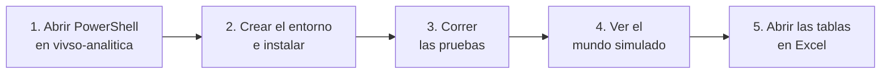

# Cómo levantar y probar el servicio

Una guía corta para instalar el servicio en Windows y verlo funcionar. Hoy se puede ver el **origen simulado**: un
mundo inventado con las mismas tablas y reglas que el sistema de Desarrollo. La API, el tablero y la conexión a la base
real llegan más adelante.



## Antes de empezar

- **Windows** con **Python 3.13** instalado desde [python.org](https://www.python.org/downloads/) (con el lanzador `py`,
  que viene marcado por defecto). Para comprobarlo: `py -3.13 --version`.
- **Conexión a internet**, solo la primera vez, para instalar las dependencias.

## 1. Abrir PowerShell en la carpeta

En el Explorador de archivos, entrar a la carpeta `vivso-analitica`, escribir `powershell` en la barra de direcciones
y apretar Enter. Todos los comandos de esta guía se escriben ahí.

## 2. Crear el entorno e instalar (una sola vez)

```powershell
py -3.13 -m venv .venv
.venv\Scripts\python.exe -m pip install -r requirements-dev.txt
```

El primer comando crea la carpeta `.venv` con un Python propio del proyecto; el segundo instala lo que hace falta
(tarda uno o dos minutos).

> Usamos siempre `.venv\Scripts\python.exe -m …` en vez de activar el entorno: en carpetas con «°» o «Ñ» en la ruta,
> los atajos del entorno virtual a veces fallan, y así funciona siempre.

## 3. Correr las pruebas

```powershell
.venv\Scripts\python.exe -m pytest
```

Lo esperado es una fila de puntos y al final:

```
174 passed
```

Si aparece una `F` o la palabra `failed`, algo está mal: la salida dice qué prueba falló y por qué. Las pruebas no usan
internet ni datos reales.

## 4. Ver el mundo simulado

```powershell
.venv\Scripts\python.exe -m analitica simular --hasta 2026-10-15
```

Muestra cómo vería el sistema de Desarrollo ese día. La salida es esta (la misma en cualquier máquina, porque el mundo
sale de una semilla fija):

```
Origen simulado · semilla 8 · corte 2026-10-15 23:59
Filas por tabla:
  solicitudes                  183
  familias                     183
  viviendas                    134
  etapas                       720
  fotos_etapa                 2709
  visitas_iniciales            165
  fotos_visita                 587
  visitas_obra                   0
  organizaciones                12
  solicitudes_organizacion      16
  integrantes                   42
  usuarios                      34
  documentos                  1246
  notificaciones              2766
Notificaciones: 2766 (una por destinatario; son la historia de las etapas)
Obras por etapa actual:
  Etapa 1: Replanteo y cimientos (EN_CURSO)               2
  Etapa 1: Replanteo y cimientos (EN_REVISION)            4
  Etapa 2: Mampostería de cimientos (EN_CURSO)            3
  ...
  Etapa 6: Pintura y artefactos (OBSERVADA)               2
  Obra finalizada                                        74
Relaciones: sin filas huérfanas
```

Cómo leerla:

- **Filas por tabla:** cuántas filas tiene cada una de las 14 tablas que el servicio lee del sistema de Desarrollo.
- **Notificaciones:** los avisos que el sistema de Desarrollo guarda en cada paso de una etapa (uno por cada persona que
  lo recibe). Con ellos el servicio reconstruye la historia de cada obra.
- **Obras por etapa actual:** cada obra en la etapa en la que está y su estado, como lo muestra la web de Desarrollo, u
  «Obra finalizada» si ya aprobó las 6. Algunas aparecen `PRORROGADA`: les dieron más tiempo y se pueden enviar igual
  (hasta el 31/10/2026 quedaban trabadas; está explicado en [simulacion.md](simulacion.md)).
- **Relaciones:** que no haya filas que apunten a algo que no existe (por ejemplo, una etapa sin su solicitud).

Para probar otras cosas:

| Qué quiero ver | Comando |
| :--- | :--- |
| El mismo mundo un mes antes (menos solicitudes, menos etapas) | `.venv\Scripts\python.exe -m analitica simular --hasta 2026-09-15` |
| El mundo de hoy | `.venv\Scripts\python.exe -m analitica simular` |
| Otro mundo inventado | `.venv\Scripts\python.exe -m analitica simular --hasta 2026-10-15 --semilla 9` |
| La ayuda de los comandos | `.venv\Scripts\python.exe -m analitica --help` |

## 5. Abrir las tablas en Excel

```powershell
.venv\Scripts\python.exe -m analitica simular --hasta 2026-10-15 --csv salidas\simulado
```

Al final dice `CSV: 14 archivos en salidas\simulado`. Esa carpeta tiene una planilla por tabla (`etapas.csv`,
`solicitudes.csv`, etc.) que se abre con doble clic en Excel. Los nombres, DNI y CUIT son inventados.

## Extras

**Apagar el simulador.** El servicio elige de dónde lee con la variable `ANALITICA_ORIGEN`. Con `vacio`, no usa el
simulador:

```powershell
$env:ANALITICA_ORIGEN = "vacio"
.venv\Scripts\python.exe -m analitica simular --hasta 2026-10-15
```

La primera línea pasa a ser `Aviso: ANALITICA_ORIGEN=vacio; el servicio no usa el simulador. Esto es solo una vista del
simulador.` Para volver atrás: `Remove-Item Env:ANALITICA_ORIGEN` (o cerrar PowerShell).

**Bajar los feriados.** Necesita internet; los deja en `datos_locales\feriados\` para trabajar sin conexión:

```powershell
.venv\Scripts\python.exe -m analitica feriados 2025 2026
```

Muestra una línea por año, por ejemplo `2026: 20 feriados (descarga)`. Sin internet usa los feriados nacionales de
respaldo y lo avisa.

## Si algo falla

| Mensaje | Qué hacer |
| :--- | :--- |
| `py` no se reconoce como comando | Instalar Python 3.13 desde python.org con la opción del lanzador `py` marcada |
| `No module named analitica` | El comando se corrió fuera de la carpeta `vivso-analitica`: volver al paso 1 |
| `No module named pandas` (u otro paquete) | Falta instalar: repetir el segundo comando del paso 2 |
| `ConfiguracionInvalida: ANALITICA_ORIGEN=...` | La variable tiene un valor que no existe: `Remove-Item Env:ANALITICA_ORIGEN` |
