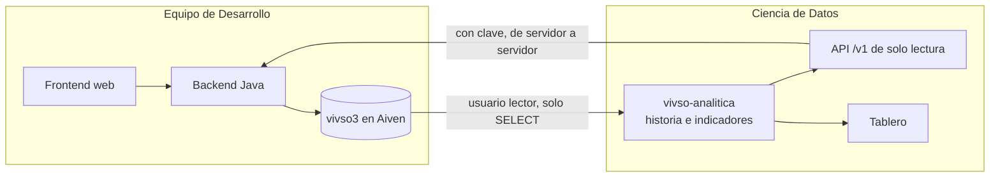

# Pedido al equipo de Desarrollo

**De:** Ciencia de Datos (Grupo 8) · **Para:** equipo de Desarrollo · **Fecha:** 04/11/2026
**Sobre:** el repositorio `PaganiB/vivso`, rama `develop`, revisada el 04/11/2026 (commit `5b36d7d`, del 03/11/2026)

## 1. Qué hacemos

Armamos un servicio que **solo lee** lo que carga el sistema de ustedes, guarda la historia que el sistema no guarda
(cada revisión y cada prórroga pisan la anterior) y calcula indicadores: cuánto dura cada etapa contra lo estimado,
cuántas se prorrogan, dónde se observa más, cuánto tarda la revisión del técnico, cómo va cada organización y cómo
avanza el trámite de las solicitudes. Los publica en una API JSON y en un tablero.

Proponemos reemplazar el acuerdo «Python no expone API» por este: **Python lee `vivso3` y expone indicadores; nunca
escribe en `vivso3`.**

## 2. Lo que ya nos dieron

Gracias por la base de pruebas en Aiven, el usuario de solo lectura `lector`, el `SHOW CREATE TABLE` de las tablas y
las respuestas del 19/10. Y por lo que resolvieron desde el 21/10:

- **La vista del arquitecto para asignar el técnico** (27/10): era lo más urgente, porque sin técnico asignado no se
  podía iniciar ninguna obra.
- **El envío de una etapa prorrogada** (31/10): ya no queda trabada.
- **Lo necesario para levantar el sistema:** el `pom.xml`, un solo `SecurityConfig`, la carpeta de archivos por variable
  de entorno y un solo mapeador.
- **Las notificaciones** (03/11): guardan con hora exacta cada paso de las etapas y no se borran. Son casi la tabla de
  eventos que les habíamos sugerido: con ellas recuperamos la historia completa de cada obra.

Con todo eso actualizamos nuestro origen simulado, que reproduce sus tablas y sus reglas, para seguir avanzando sin
depender de ustedes.

## 3. Lo que falta para conectarnos

1. La **contraseña** del usuario `lector`.
2. El **certificado de la autoridad (CA)** de Aiven, para la conexión cifrada.
3. Que `lector` pueda leer la tabla nueva `notificacion` (solo `id_notificacion`, `id_usuario`, `tipo`,
   `id_referencia`, `fecha` y `leida`) y las columnas nuevas `nombre` y `apellido` de `usuario`.

Por un canal privado, por favor: nunca por el repositorio ni por un grupo. Nosotros los guardamos solo en el `.env` de
cada máquina, que no se sube.

## 4. Preguntas

1. **Rama vigente.** El 04/11 la rama `main` quedó casi vacía. ¿Seguimos leyendo `develop` como la versión de
   referencia?
2. **Etapa rechazada.** `rechazarEtapa` deja la etapa `RECHAZADA` y ninguna regla la saca de ahí. ¿Qué pasa después de
   un rechazo (se reinicia la etapa, se cierra la obra)? Además, la ruta `POST /etapa/{id}/rechazar` no figura en
   `SecurityConfig` (queda solo para `ADMIN`), pero el servicio exige que quien rechaza sea el técnico asignado: hoy
   nadie puede rechazar. ¿Es a propósito?
3. **Zona horaria.** Las etapas y las fotos usan `LocalDateTime.now(ZONA)` con la hora de Buenos Aires, pero los
   documentos, las solicitudes, las altas y ahora las **notificaciones** usan `LocalDateTime.now()` y `LocalDate.now()`
   sin zona, y la URL de conexión declara `serverTimezone=UTC`. ¿En qué zona corre la JVM? Si corre en UTC, esas fechas
   quedan tres horas adelantadas y, después de las 21, con la fecha del día siguiente.
4. **Municipios y comisiones municipales.** `TipoOrganizacion` no tiene un tipo para ellos. ¿Cómo se registra una
   municipalidad? (Para nosotros son el grupo OG; hoy lo deducimos del nombre si eligen «Otra».)
5. **Feriados provinciales.** Nos dijeron que, ante un feriado provincial, el técnico reasignaría la fecha límite sin
   que cuente como prórroga. ¿Cómo va a quedar marcado? Hoy, para nosotros, cualquier cambio de `fecha_limite` es una
   prórroga.
6. **Tope de prórroga.** `TOPE_PRORROGA_DIAS = 14`, ¿son días hábiles? Así lo estamos contando.
7. **`cpe`.** ¿Qué guarda la columna `cpe` de las organizaciones?
8. **Tabla de feriados.** Cuando agreguen la tabla `feriado`, ¿con qué columnas? La leeríamos para contar igual que
   ustedes.
9. **`notificacion.leida`.** ¿Queda como `bit(1)`, como `activo`?

## 5. Sugerencias para medir mejor

1. **Sumar a cada notificación la etapa (`id_etapa_obra`) y quién hizo la acción.** Hoy la notificación dice la
   solicitud, y la etapa la deducimos contando las aprobaciones anteriores.
2. **La hora de captura del celular** en los envíos y las fotos de etapa, como ya hace la visita inicial. Con el modo
   sin conexión, una demora de señal hoy se ve como una demora de obra.
3. **Exigir al menos una foto para enviar una etapa** (el código ya lo tiene anotado como pendiente): el técnico aprueba
   a distancia y las fotos son la única evidencia.
4. **Las fechas de semiaprobación y de rechazo** de una solicitud.
5. **Borrar las fotos con una marca** en vez de borrar la fila, para saber que existieron.

## 6. Lo que vemos en el código y afecta a la analítica

| Dónde | Qué pasa |
| :--- | :--- |
| `EtapaObraService.rechazarEtapa` | La etapa `RECHAZADA` no tiene salida y hoy nadie puede rechazar (pregunta 2) |
| `EtapaObraService.aprobarEtapa` | Aprobar la etapa 6 no cierra la solicitud |
| `Vivienda.fechaInic` y `Vivienda.fechaFin` | Ningún flujo los completa |
| `vivienda.avance_obra` y la tabla `visitaObra` | Restos del AFO anterior que siguen en la base, aunque el código ya no los usa |
| `NotificacionService` | Las notificaciones de la organización solo se guardan si tiene integrantes activos con usuario |
| `solicitud_organizacion` | `cuit` es único: una organización rechazada no puede volver a pedir el alta. Y la vigencia es obligatoria en `organizacion` pero no en la solicitud: aprobar un alta sin esa fecha fallaría |

## 7. Lo que ofrecemos

- **Una API JSON de solo lectura** (`/v1`), con clave, para mostrar los indicadores en su web o en la app, idealmente
  consultándola desde su backend: estado del servicio, obras con su semáforo y su avance, la ficha y la línea de tiempo
  de cada obra, indicadores, resumen por etapa, organizaciones, técnicos y circuito documental.
- **El catálogo de indicadores**, con la pregunta que responde cada uno y cómo leerlo.
- **El tablero**, para el área y para ustedes.
