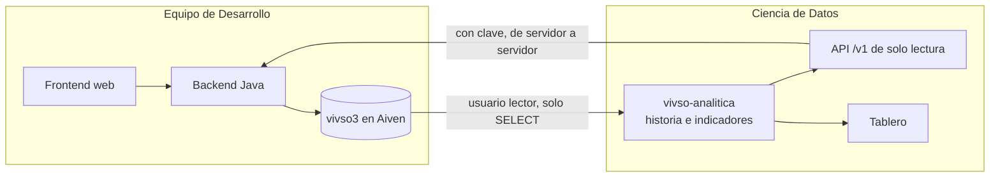

# Pedido al equipo de Desarrollo

**De:** Ciencia de Datos (Grupo 8) · **Para:** equipo de Desarrollo · **Fecha:** 21/10/2026
**Sobre:** el repositorio `PaganiB/vivso`, revisado el 21/10/2026 (commit `bb957fd`)

## 1. Qué hacemos

Armamos un servicio que **solo lee** lo que carga el sistema de ustedes, guarda la historia que el sistema no guarda
(cada revisión y cada prórroga pisan la anterior) y calcula indicadores: cuánto dura cada etapa contra lo estimado,
cuántas se prorrogan, dónde se observa más, cuánto tarda la revisión del técnico, cómo va cada organización y cómo
avanza el trámite de las solicitudes. Los publica en una API JSON y en un tablero.

Proponemos reemplazar el acuerdo «Python no expone API» por este: **Python lee `vivso3` y expone indicadores; nunca
escribe en `vivso3`.**

## 2. Lo que ya nos dieron

Gracias por la base de pruebas en Aiven, el usuario de solo lectura `lector`, el `SHOW CREATE TABLE` de las 13 tablas y
las respuestas del 19/10 (visitas de obra, tabla `visita`, etapa 6, técnico asignado, feriados y hora de captura). Con
eso construimos un origen simulado que reproduce sus tablas y sus reglas, para avanzar con el servicio sin depender de
ustedes.

## 3. Lo que falta para conectarnos

1. La **contraseña** del usuario `lector`.
2. El **certificado de la autoridad (CA)** de Aiven, para la conexión cifrada.

Por un canal privado, por favor: nunca por el repositorio ni por un grupo. Nosotros los guardamos solo en el `.env` de
cada máquina, que no se sube.

## 4. Preguntas

1. **Zona horaria.** Las etapas y las fotos usan `LocalDateTime.now(ZONA)` con la hora de Buenos Aires, pero los
   documentos (`fechaSubida`, `fechaRevision`), las solicitudes (`fechaSolicitud`, `fechaActivacion`) y las altas usan
   `LocalDateTime.now()` y `LocalDate.now()` sin zona, y la URL de conexión declara `serverTimezone=UTC`. ¿En qué zona
   corre la JVM? Si corre en UTC, esas fechas quedan tres horas adelantadas y, después de las 21, con la fecha del día
   siguiente.
2. **Feriados provinciales.** Nos dijeron que, ante un feriado provincial, el técnico reasignaría la fecha límite sin
   que cuente como prórroga. ¿Cómo va a quedar marcado? Hoy, para nosotros, cualquier cambio de `fecha_limite` es una
   prórroga.
3. **Tope de prórroga.** `TOPE_PRORROGA_DIAS = 14`, ¿son días hábiles? Así lo estamos contando.
4. **`cpe`.** ¿Qué guarda la columna `cpe` de las organizaciones?
5. **Tabla de feriados.** Cuando agreguen la tabla `feriado`, ¿con qué columnas? La leeríamos para contar igual que
   ustedes.

## 5. Sugerencias para medir mejor

1. **Una tabla de eventos de etapa** en la que solo se agreguen filas, por ejemplo con `id_etapa_obra`, `tipo`, `fecha`,
   `id_usuario`, `estado_anterior`, `estado_nuevo`, `fecha_limite_anterior` y `fecha_limite_nueva`. Hoy se pierde
   cuántas veces se observó o se prorrogó una etapa; la reconstruimos leyendo cada cierto tiempo, con menos precisión.
2. **La hora de captura del celular** en los envíos y las fotos de etapa, como ya hace la visita inicial. Con el modo
   sin conexión, una demora de señal hoy se ve como una demora de obra.
3. **Quién y cuándo prorrogó** una etapa.
4. **Las fechas de semiaprobación y de rechazo** de una solicitud.
5. **Borrar las fotos con una marca** en vez de borrar la fila, para saber que existieron.

## 6. Lo que vemos en el código y afecta a la analítica

| Dónde | Qué pasa |
| :--- | :--- |
| `Solicitud.tecnicoAsignado` y `EtapaObraService.validarTecnicoAsignado` | **Lo más urgente.** Solo el técnico asignado puede iniciar la obra y aprobar, observar o prorrogar sus etapas (sin excepción para `ADMIN`), pero ningún flujo completa `tecnicoAsignado`: hoy no se puede iniciar ninguna obra. Además, la app del técnico filtra por ese campo y queda vacía. Hace falta la vista del arquitecto para asignarlo |
| `EtapaObraService.enviarEtapa` | Solo acepta etapas `EN_CURSO` u `OBSERVADA`: una etapa `PRORROGADA` ya no puede enviarse y queda trabada |
| `EtapaObraService.aprobarEtapa` | Aprobar la etapa 6 no cierra la solicitud |
| `Vivienda.fechaInic` y `Vivienda.fechaFin` | Ningún flujo los completa |
| `visitaObra.afo` y `vivienda.avance_obra` | Restos del AFO anterior que siguen en la base |
| `solicitud_organizacion` | `cuit` es único: una organización rechazada no puede volver a pedir el alta. Y la vigencia es obligatoria en `organizacion` pero no en la solicitud: aprobar un alta sin esa fecha fallaría |

## 7. Para levantar el sistema

- Falta el `pom.xml` en el repositorio.
- Hay dos clases `SecurityConfig` con el mismo nombre: Spring les asigna el mismo nombre de bean y falla al arrancar.
- `vivso.upload.dir` se usa sin valor por defecto y no está definida.
- `Mapper/Mapper.java`, que nadie usa, llama a métodos que `Vivienda` ya no tiene y no compila.

## 8. Lo que ofrecemos

- **Una API JSON de solo lectura** (`/v1`), con clave, para mostrar los indicadores en su web o en la app, idealmente
  consultándola desde su backend: estado del servicio, obras con su semáforo y su avance, la ficha y la línea de tiempo
  de cada obra, indicadores, resumen por etapa, organizaciones, técnicos y circuito documental.
- **El catálogo de indicadores**, con la pregunta que responde cada uno y cómo leerlo.
- **El tablero**, para el área y para ustedes.
