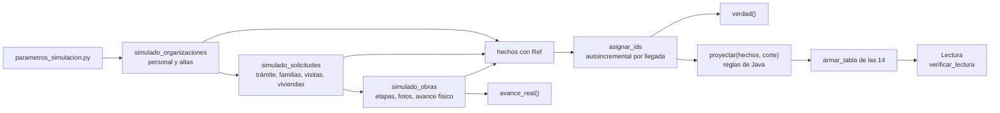
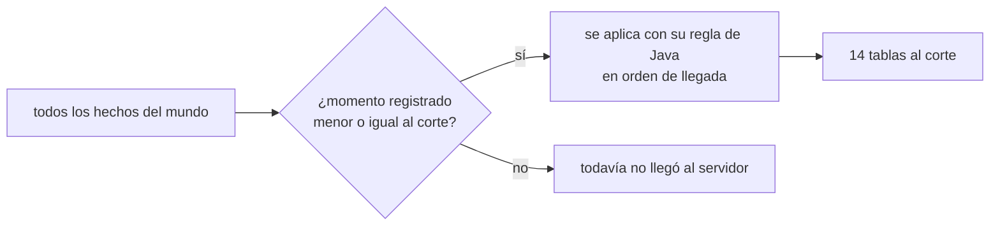
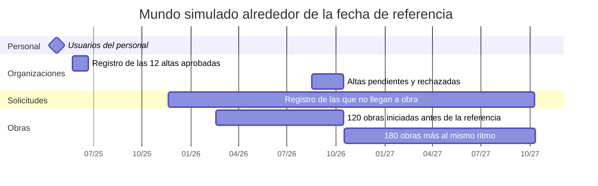
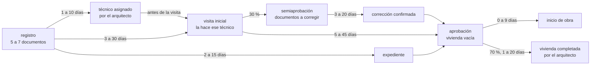
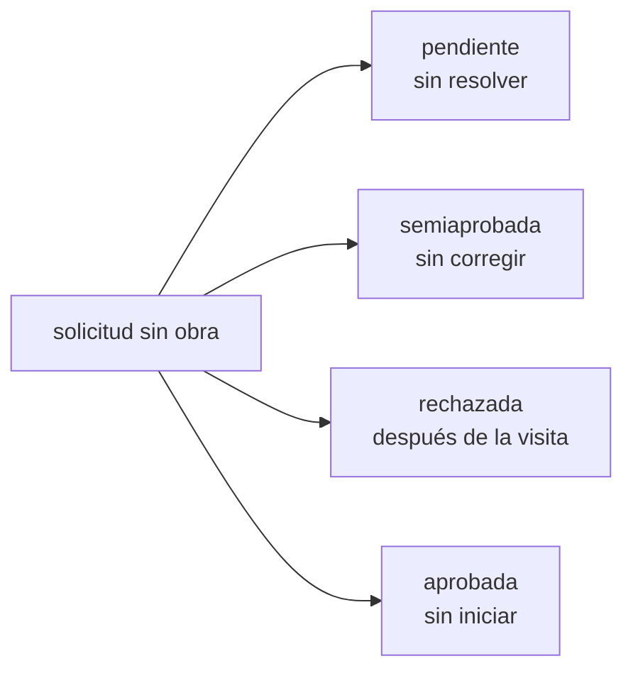
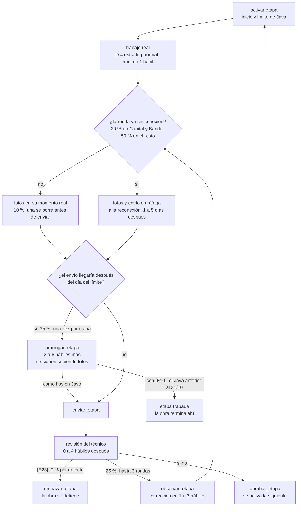
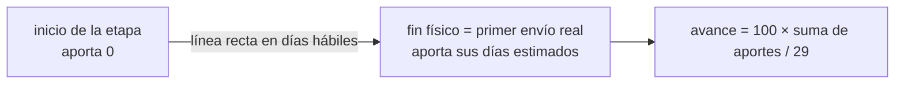
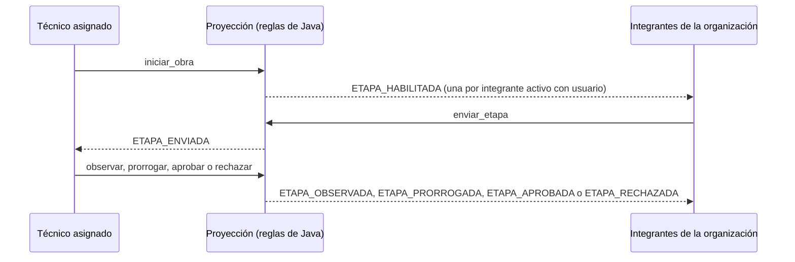
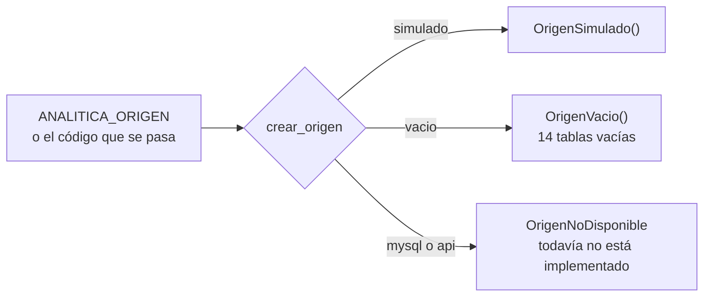

# El origen simulado

## 1. Para qué

El servicio tiene que funcionar de punta a punta **sin depender de Desarrollo**: mientras no haya acceso a la base
real, lee un mundo inventado que tiene las mismas 14 tablas y respeta las mismas reglas que el sistema de Java
(ver [sistema-de-desarrollo.md](sistema-de-desarrollo.md)). Además, como el simulador sabe lo que pasó de verdad, sirve
de vara para evaluar el servicio: cuánta historia recupera, qué tan exacto es el avance de obra y cuánto se equivocan
los indicadores.

## 2. Cómo funciona

El simulador tiene dos capas:

1. **La verdad:** los hechos de cada flujo —un alta de organización, el registro de una solicitud, una foto, un envío,
   una revisión, una prórroga—, cada uno con su **momento real** (cuándo pasó), su **momento registrado** (cuándo llegó
   al servidor, que es la hora que guarda Java) y su **autor**. Las personas, los CUIT y los textos son inventados
   (Faker en español de Argentina y correos `@example.com`). Todo sale de generadores sembrados: la misma semilla da
   siempre el mismo mundo.
2. **La proyección:** aplica los hechos, en el orden en que llegaron al servidor, con las reglas de los servicios de
   Java: las mismas precondiciones, los mismos campos que se pisan, la vivienda vacía al aprobar, las fotos que se
   borran sin rastro y las notificaciones que deja cada acción sobre una etapa. Los ids se asignan como el
   autoincremental de MySQL: en orden de llegada.



Una lectura muestra el mundo **a un corte**: solo lo que llegó al servidor hasta ese momento. Un envío hecho sin
conexión antes del corte, pero que llegó después, todavía no aparece.



## 3. El mundo alrededor de la fecha de referencia

El mundo se arma alrededor de una **fecha de referencia fija** (15/10/2026) y no depende del corte. Así, dos lecturas
con cortes distintos ven el mismo mundo en dos momentos —lo que necesita la sincronización para reconstruir la
historia— y la demo sigue viva con el paso de los días: después de la referencia siguen llegando obras al mismo ritmo.



## 4. Un trámite y una etapa simulados

El trámite de una solicitud (días corridos):



Las solicitudes que no llegan a obra se reparten por partes iguales:



Una etapa de obra, ronda por ronda:



El avance físico real de cada obra ([E18]) es la vara contra la cual se evalúa el AFO:



Cada acción sobre una etapa deja notificaciones, como en el sistema de Desarrollo ([E24]): son las que después permiten
reconstruir la historia de cada obra.



**Cómo queda el mundo a la fecha de referencia.** Con la semilla 8, de las 120 obras iniciadas, 74 terminaron y 46 siguen
en curso (7 de ellas prorrogadas, que se pueden enviar igual); ninguna queda trabada y hay 2766 notificaciones. Hasta el
31/10/2026 el sistema de Desarrollo no dejaba enviar una etapa prorrogada, y con los mismos supuestos 93 de las 120 obras
quedaban trabadas: Desarrollo lo arregló, y el simulador puede reproducir el comportamiento anterior con
`error_prorroga_java=True` ([E10]).

## 5. Cómo se usa

Desde la línea de comandos:

```powershell
.venv\Scripts\python.exe -m analitica simular --hasta 2026-10-15
.venv\Scripts\python.exe -m analitica simular --hasta 2026-10-15 --csv salidas\simulado
```

Muestra las filas de cada tabla, las obras por etapa actual (como las muestra la web de Desarrollo) y si hay filas
huérfanas; con `--csv` guarda las 14 tablas. La semilla por defecto es 8 y el corte por defecto, ahora.

Desde Python:

```python
from datetime import date
from analitica.origenes.simulado import OrigenSimulado

origen = OrigenSimulado(semilla=8, hasta=date(2026, 10, 15))
lectura = origen.leer()                           # las 14 tablas al corte
antes = origen.leer_al(date(2026, 9, 15))         # el mismo mundo, un mes antes
hechos = origen.verdad()                          # lo que pasó de verdad, con ids
origen.avance_real(id_solicitud=12, dia=date(2026, 10, 15))
```

## 6. Cómo se apaga

Con `ANALITICA_ORIGEN=vacio` el servicio no usa el simulador: el origen vacío devuelve las 14 tablas sin filas. El
comando `simular` sigue mostrando el simulador, pero avisa que el servicio no lo está usando.



## 7. Supuestos

Están en `analitica/parametros_simulacion.py`, cada uno con su etiqueta. Los rangos incluyen los dos extremos y un mes
son 30 días.

| Etiqueta | Supuesto | Valor |
| :--- | :--- | :--- |
| `[E1]` | Obras | 120 iniciadas en los 8 meses previos a la fecha de referencia (15/10/2026) y el mismo ritmo (15 por mes) durante los 12 meses siguientes: 300 en total |
| `[E2]` | Organizaciones | 12 altas aprobadas, 2 pendientes y 2 rechazadas; el 30 % de las aprobadas pasa por una observación; cada paso del alta tarda 3 a 20 días; 30 % de OG (municipalidades y comisiones municipales, sin repetir departamento) con tipo «Otra», porque el sistema de Desarrollo no tiene un tipo para ellas, y el resto ONG («Asociación Civil» y «Cooperativa») |
| `[E3]` | Usuarios | 6 técnicos, 2 operadores, 1 arquitecto y 1 administrador, con nombre y apellido; presidente y tesorero de cada organización con usuario `INTEGRANTE`, sin nombre ni apellido (como los crea el alta); de 0 a 3 integrantes más sin usuario |
| `[E4]` | Duración real de una etapa | días estimados × factor log-normal (mediana 1,2; desvío 0,35), en días hábiles, mínimo 1 |
| `[E5]` | Observación de un envío | 0,25 por ronda; a lo sumo 3 rondas |
| `[E6]` | Corrección tras una observación | 1 a 3 días hábiles |
| `[E7]` | Prórroga cuando la etapa se va a vencer | probabilidad 0,35, a lo sumo una por etapa; agrega 2 a 6 días hábiles; después de la prórroga se pueden seguir subiendo fotos, pero no borrarlas |
| `[E8]` | Espera de la revisión del técnico | 0 a 4 días hábiles |
| `[E9]` | Carga sin conexión | envíos y fotos de etapa que llegan 1 a 5 días después (más 0 a 10 horas): 20 % de las rondas en Capital y Banda, 50 % en el resto |
| `[E10]` | Error de Java en etapas prorrogadas | desactivado, como en el sistema de Desarrollo desde el 31/10/2026; activado reproduce el comportamiento anterior: una etapa prorrogada no puede enviarse y queda trabada |
| `[E11]` | Solicitudes que no llegan a obra | 25 % (100): pendientes, semiaprobadas, rechazadas o aprobadas sin iniciar, por partes iguales |
| `[E12]` | Familias | 1 a 8 familiares; antigüedad del rancho de 5 a 40 años |
| `[E13]` | Trámite de la solicitud | expediente a los 2 a 15 días; visita inicial a los 3 a 30 días del registro; 30 % semiaprobadas, con corrección en 3 a 20 días; aprobación 5 a 45 días después de la visita; obra iniciada 0 a 9 días después de aprobada |
| `[E14]` | Documentos de familia | 5 a 7 al registrar la solicitud; el 20 % se marca para corregir y se reemplaza en 2 a 10 días |
| `[E15]` | Vivienda | el arquitecto la completa en el 70 % de los casos, 1 a 20 días después de aprobada; tipo `URBANA` 45 %, `RURAL` 45 %, `ECONOMICA` 10 %; 40 a 60 m²; 2 o 3 dormitorios |
| `[E16]` | Visitas de obra | ninguna, como en el flujo nuevo; un parámetro las activa (una por etapa aprobada) |
| `[E17]` | Fotos de etapa | 2 a 6 por ronda; en el 10 % de las rondas con conexión se borra una antes de enviar; en el 5 % de las rondas se envía sin fotos |
| `[E18]` | Avance físico real | crece en línea recta con los días hábiles de cada etapa, desde que se activa hasta su primer envío real |
| `[E19]` | Técnico asignado | el arquitecto lo asigna 1 a 10 días después del registro y siempre antes de la visita inicial, que hace ese técnico; de las solicitudes que quedan pendientes sin visita, la mitad ya tiene técnico. Con el parámetro apagado no se asigna ninguno y ninguna solicitud pasa de pendiente (sin técnico asignado, el sistema de Desarrollo no deja hacer la visita ni iniciar la obra) |
| `[E20]` | Visita inicial | clasificación con pesos inventados (la más frecuente, `TIPO_2A`, 20 %); habitantes = familiares ± 1; prioridad social 30 %; 2 a 5 fotos |
| `[E21]` | Textos | motivos y observaciones de listas fijas inventadas; la organización deja un texto en el 50 % de los envíos |
| `[E22]` | Ubicación | el 70 % de las solicitudes en el departamento de la organización; coordenadas alrededor de la cabecera (desvío 0,05°) dentro de la provincia |
| `[E23]` | Rechazo de etapa | probabilidad 0 en cada revisión, porque hoy nadie puede rechazar una etapa en el sistema de Desarrollo; con un valor mayor, el técnico rechaza en vez de aprobar u observar y la obra se detiene ahí |
| `[E24]` | Notificaciones | se guardan como en el sistema de Desarrollo: una por integrante activo con usuario (inicio de obra, aprobación, observación, prórroga y rechazo) y una para el técnico asignado (envío), con la hora de llegada más un desfase de 0 horas (3 sirve para probar un servidor en hora UTC), sin marcar como leídas |
| `[S15]` | Departamentos | los 18 departamentos de Santiago del Estero con su cabecera, sus coordenadas y su peso de población, del simulador de PP2 |

## 8. Lo que no modela

- No reasigna técnicos: el que asigna el arquitecto hace la visita, inicia la obra y revisa todas sus etapas.
- No rechaza etapas por defecto ([E23]), porque hoy nadie puede hacerlo en el sistema de Desarrollo.
- Nadie lee las notificaciones: quedan todas sin leer.
- El calendario del simulador no cuenta feriados, como Java hoy.
- A lo sumo una prórroga por etapa.
- Las visitas iniciales no tienen demora de conexión (guardan la hora del celular, como en Java).
- Lo que se borra en el celular sin conexión nunca llega al servidor, así que no se ve.
- Las personas, los CUIT, las direcciones y los textos son inventados: no describen el programa real.
