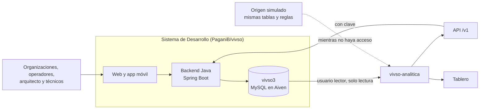
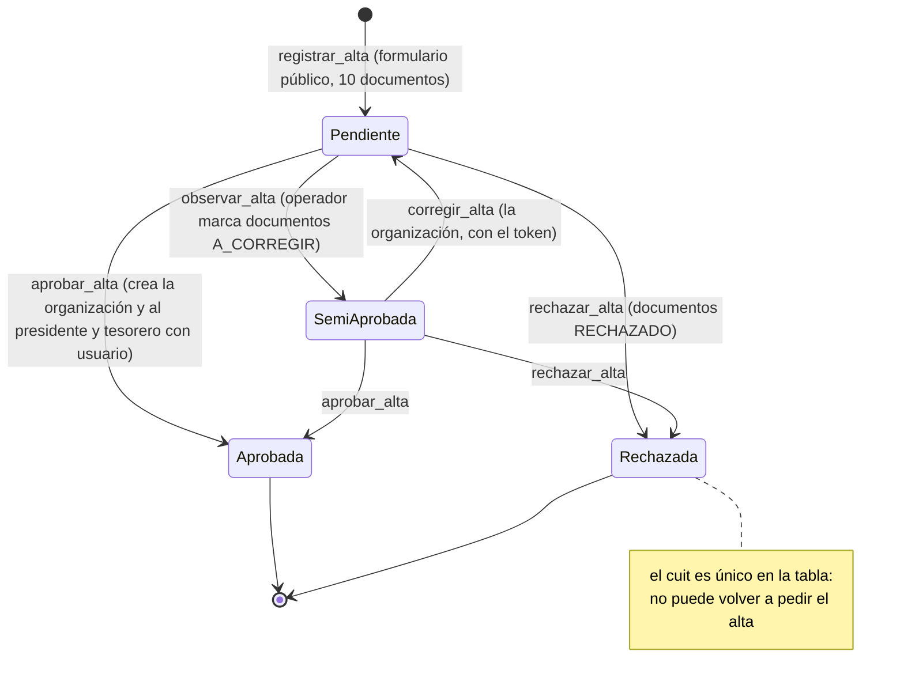
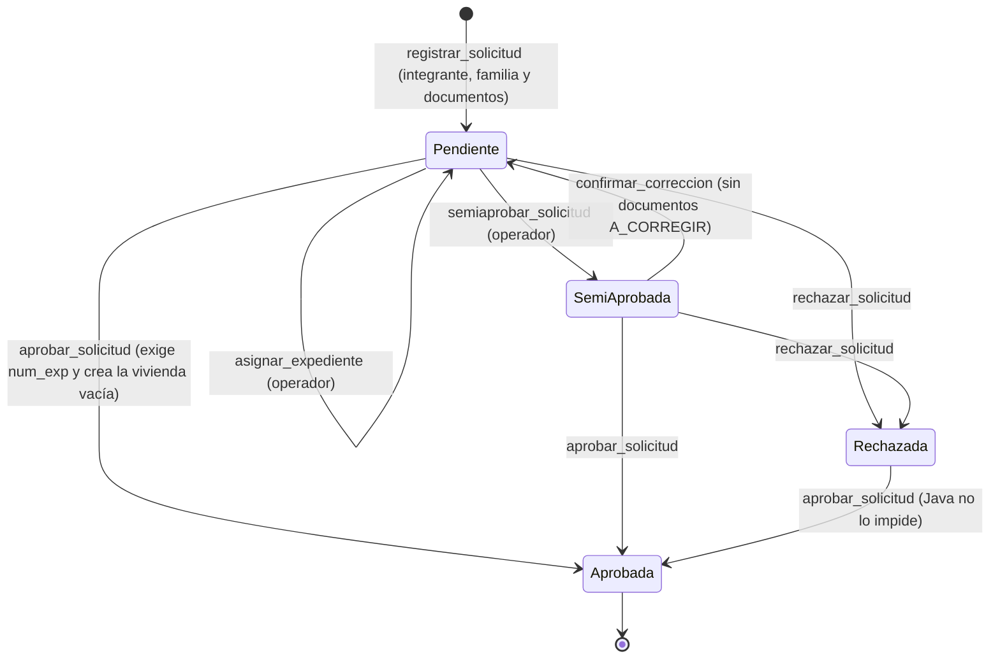
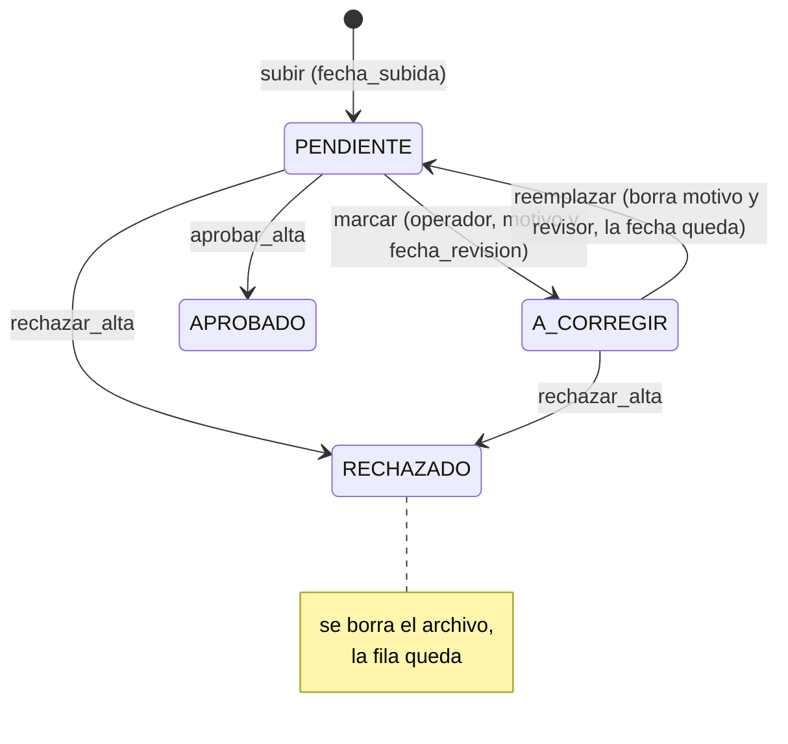
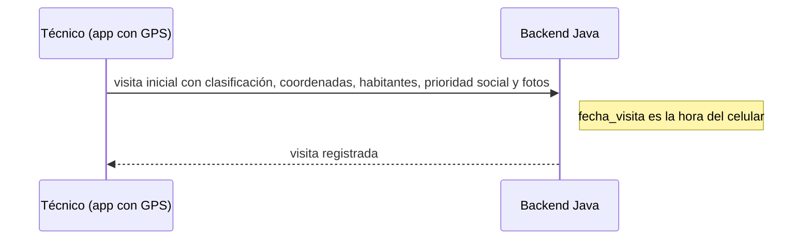
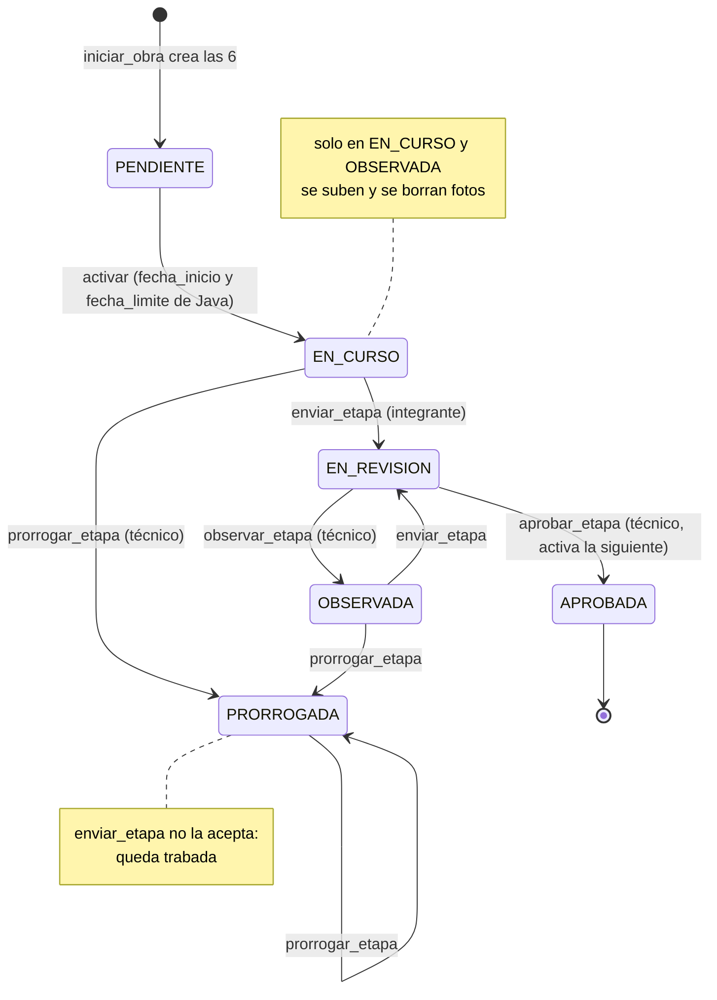
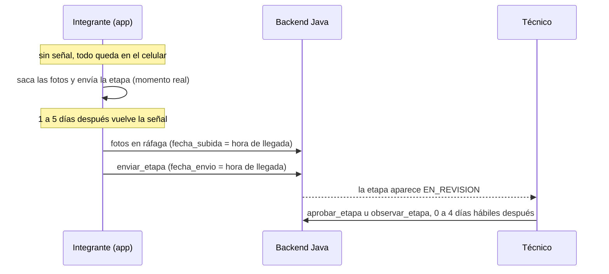
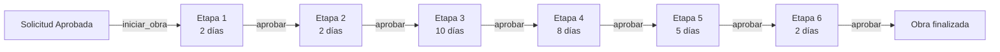
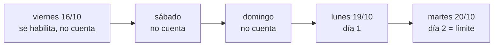

# El sistema de Desarrollo que leemos

Este documento describe el sistema que construye el equipo de Desarrollo y que este servicio lee: quién hace qué,
por qué estados pasa cada cosa, qué tablas guarda y qué huecos tiene para el análisis. Todo lo que dice sale de su
código y de lo que nos respondieron; el servicio copia de ahí el dominio en vez de inventarlo.

## 1. Qué es

- **Repositorio:** `PaganiB/vivso`, revisado el 21/10/2026 (último commit `bb957fd`, del 19/10/2026).
- **Tecnología:** Java 17, Spring Boot y JPA. La base es MySQL (`vivso3`), administrada en Aiven. El esquema lo genera
  Hibernate con `ddl-auto=update`: agrega columnas pero nunca las borra.
- **Enums:** se guardan como texto (`EnumType.STRING`), así que la base tiene el nombre del enum (`ETAPA_1`, `TIPO_1A`)
  y la API devuelve su valor (`"1a"`).
- **Zona horaria:** `America/Argentina/Buenos_Aires` en las etapas y las fotos (ver el punto 7.10).
- **Auditoría de JPA** activa (`@EnableJpaAuditing`).

## 2. Roles

| Rol | Qué hace |
| :--- | :--- |
| `ADMIN` | Todo, incluido borrar |
| `OPERADOR` | Asigna el expediente; aprueba, semiaprueba y rechaza solicitudes; aprueba, observa y rechaza altas de organización; marca documentos para corregir |
| `ARQUITECTO` | Completa los datos de la vivienda; va a asignar el técnico de cada solicitud (falta esa vista) |
| `TECNICO` | Hace la visita inicial, inicia la obra, aprueba, observa y prorroga etapas |
| `INTEGRANTE` | Registra solicitudes de familias, confirma correcciones, reemplaza documentos, sube las fotos de las etapas y las envía a revisión |

## 3. Flujos

### 3.1 Alta de organización

Una organización pide el alta con un formulario público: queda una solicitud de organización `Pendiente` con
`fechaSolicitud` y sus documentos en `PENDIENTE`. El operador puede observarla (`SemiAprobada`, con un motivo, los
campos observados y los documentos a corregir), y la organización corrige con un enlace de edición. Al aprobarla se crea
la organización, y el presidente y el tesorero quedan como integrantes activos, cada uno con un usuario `INTEGRANTE`
(`username` = `nombre.apellido`). Al rechazarla, sus documentos quedan `RECHAZADO`: se borra el archivo, la fila queda.

### 3.2 Solicitud de vivienda

Un integrante registra a la familia, sus familiares y sus documentos: la solicitud queda `Pendiente`. El operador le
asigna el número de expediente, que es obligatorio para aprobar. Puede semiaprobarla (`SemiAprobada`, con una
observación y los campos observados); el integrante confirma la corrección cuando no quedan documentos para corregir, y
la solicitud vuelve a `Pendiente` sin la observación. Al aprobarla se guarda `fechaActivacion` y el revisor, y se crea
la vivienda **vacía**: solo con la familia y la solicitud. Java solo impide aprobar una solicitud ya aprobada.

### 3.3 Vivienda

El arquitecto completa departamento, localidad, dirección, barrio, superficie, tipo, dormitorios y coordenadas. El
tipo (`URBANA`, `RURAL`, `ECONOMICA`) es el **prototipo**: define el presupuesto y los planos, no la ubicación.
`fechaInic` y `fechaFin` no las completa ningún flujo.

### 3.4 Documentos

`APROBADO` y `RECHAZADO` solo existen en el alta de organizaciones. Hay 19 tipos de documento: 10 de la organización,
7 de la familia (entre ellos el certificado de discapacidad), la foto de avance de obra y «otro».

### 3.5 Visita inicial

El técnico la hace con la app y el GPS: clasificación preliminar, coordenadas, localidad, departamento, observaciones,
habitantes encontrados, prioridad social y fotos. Es la única fecha que viene del celular.

### 3.6 Etapas de obra

Las organizaciones registran el avance y el técnico lo aprueba a distancia, con las fotos (los técnicos a veces no dan
abasto para ir). El técnico inicia la obra cuando la solicitud está aprobada: se crean las 6 etapas en `PENDIENTE` y se
activa la primera. Activar una etapa es ponerla `EN_CURSO` con `fecha_inicio` = hoy y `fecha_limite` =
`fecha_limite_original` = hoy más sus días hábiles estimados.

- El integrante sube fotos con la etapa `EN_CURSO` u `OBSERVADA` (con la hora del servidor) y puede borrarlas hasta
  enviarla; el borrado no deja rastro.
- Enviar: desde `EN_CURSO` u `OBSERVADA` → `EN_REVISION`, con la hora truncada al minuto, una observación de la
  organización (que pisa la anterior) y quién la envió.
- Aprobar (técnico): desde `EN_REVISION` → `APROBADA`, y en el mismo momento se activa la siguiente. La última
  observación del técnico no se borra.
- Observar (técnico): desde `EN_REVISION` → `OBSERVADA`, con su observación y la fecha de revisión.
- Prorrogar (técnico): desde `EN_CURSO`, `OBSERVADA` o `PRORROGADA`, con una fecha nueva posterior y hábil → `PRORROGADA`;
  pisa `fecha_limite` y el motivo. El tope de 14 días está declarado pero no se aplica, y no queda registrado quién ni
  cuándo prorrogó.
- Solo el **técnico asignado** a la solicitud puede iniciar la obra y aprobar, observar o prorrogar sus etapas
  (`validarTecnicoAsignado`, sin excepción para `ADMIN`).
- Ninguna de estas acciones recibe la hora del celular: el servidor pone la suya.

Cuando el celular no tiene señal, las fotos y el envío quedan en el teléfono y llegan juntos al reconectarse. Lo que
guarda Java es la hora de llegada:

### 3.7 El avance de obra (AFO)

Desde el 15/10/2026 el avance de obra son las 6 etapas: la etapa en curso y las aprobadas. La web de Desarrollo lo
muestra como «Etapa N: nombre (estado)» y «Obra Finalizada» cuando las 6 están aprobadas. Java no calcula un porcentaje.
Aprobada la etapa 6, la obra está terminada; la entrega sigue con un trámite administrativo.

### 3.8 Visita de obra

Es un resto del AFO anterior (`/visita-obra/movil/avance`): guarda la fecha del servidor, un `progreso` de 0 a 100 en la
columna `afo` y fotos como documentos `FOTO_OBRA`. Desarrollo la va a dejar sin efecto, porque el avance lo registran
las organizaciones.

## 4. Las 6 etapas y los plazos

| N.º | Etapa | Qué incluye | Días hábiles estimados |
| ---: | :--- | :--- | ---: |
| 1 | Replanteo y cimientos | Replanteo, excavación y llenado de cimientos | 2 |
| 2 | Mampostería de cimientos | Mampostería de cimientos, encadenado inferior con tronco de columna y capa aisladora | 2 |
| 3 | Elevación y techo | Mampostería de elevación, columnas de encadenado, encadenado superior, techo completo con aislante, apretada y colocación de aberturas | 10 |
| 4 | Revoques y contrapiso | Revoque grueso y fino interior y exterior, contrapiso y carpeta de nivelación | 8 |
| 5 | Instalaciones | Instalación eléctrica, instalación sanitaria, colocación de mesada, cámaras y pozo | 5 |
| 6 | Pintura y artefactos | Pintura interior y exterior, colocación de artefactos eléctricos y sanitarios | 2 |
| | **Total** | | **29** |

**Días hábiles** (`CalendarioService`): de lunes a viernes. Para el límite, el día de inicio no cuenta; para los días
que faltan, no cuenta hoy y sí cuenta el día del límite. El ejemplo de Java: una etapa habilitada un viernes con 2 días
vence el martes.

Los feriados todavía no se cuentan: están previstos con la API de ArgentinaDatos.

## 5. Las 13 tablas que leemos

El servicio pasa cada tabla a su formato (columnas en minúsculas con guion bajo). Solo cambian de nombre estas columnas;
las columnas completas de cada tabla están en [analitica/esquema.py](../analitica/esquema.py).

| Tabla de Java | Nuestra tabla | Columnas que cambian de nombre |
| :--- | :--- | :--- |
| `solicitud` | `solicitudes` | `numExp` → `num_exp`, `fechaSolicitud` → `fecha_solicitud`, `fechaActivacion` → `fecha_activacion`, `CUIT_org` → `cuit_org`, `camposObservados` → `campos_observados` |
| `familia` + `familiar` | `familias` | `id_familia`, la cantidad de familiares → `cantidad_familiares`, `antiguedadRancho` → `antiguedad_rancho`. De `familiar` solo se leen `id_familiar` e `id_familia` |
| `vivienda` | `viviendas` | `fechaInic` → `fecha_inicio`, `fechaFin` → `fecha_fin`, `tipoVivienda` → `tipo_vivienda`; `avance_obra` (resto del AFO anterior) se lee tal cual. La columna es `barrio`, sin espacio (en la entidad figura `"barrio "`) |
| `etapa_obra` | `etapas` | Sin cambios, más `numero` (del catálogo) |
| `foto_etapa` | `fotos_etapa` | `id_etapa` → `id_etapa_obra` |
| `visitaInicial` | `visitas_iniciales` | `id` → `id_visita`, `clasificacion_preliminar` → `clasificacion`, `cantHabitantesReal` → `habitantes`, `tienePrioridadSocial` → `prioridad_social` |
| `visita_fotos` | `fotos_visita` | Sin cambios (la tabla no tiene clave primaria) |
| `visitaObra` | `visitas_obra` | `id_usuario_tecnico` → `id_tecnico`. Si Desarrollo la borra, queda vacía sin error |
| `organizacion` | `organizaciones` | `CUIT` → `cuit` |
| `solicitud_organizacion` | `solicitudes_organizacion` | `domLegal` → `dom_legal`, `fechaVencimientoVigencia` → `fecha_vencimiento_vigencia`, `fechaUltimaAsamblea` → `fecha_ultima_asamblea`, los siete datos del presidente y los siete del tesorero (`dniPresidente` → `dni_presidente`, etc.), `fechaRechazo` → `fecha_rechazo`, `fechaAprobacion` → `fecha_aprobacion`, `fechaSolicitud` → `fecha_solicitud` |
| `integrante` | `integrantes` | `id_integranteOrganizacion` → `id_integrante`, `CUIT_org` → `cuit_org`, `DNI` → `dni` |
| `usuario` | `usuarios` | Sin cambios |
| `documento` | `documentos` | `idDocumento` → `id_documento`, `nombreOriginal` → `nombre_original`, `urlPath` → `url`, `motivoObservacion` → `motivo_observacion`, `fechaSubida` → `fecha_subida`, `fechaRevision` → `fecha_revision`, `id_organizacion` → `cuit_org`, `id_usuario_revisor` → `id_revisor` |

**Lo que no se lee nunca:** tokens, contraseñas y sus hashes. De `familia` y `familiar`, solo conteos: cuántos
familiares hay y la antigüedad del rancho. Además, el usuario `lector` ya no puede leer `password_hash` ni
`token_edicion`.

**Detalles de la base:** corre en modo ANSI (los nombres van entre acentos graves y los textos entre comillas simples);
`activo` y `tienePrioridadSocial` son `bit(1)`; `superficie` es `decimal(10,2)`; `fecha_envio`, `fecha_revision` y
`fecha_subida` de las etapas y fotos son `datetime(6)`; `documento.fechaSubida` es `datetime`; `usuario.rol` es
`tinytext`. La tabla `visita` quedó sin uso y no se lee.

## 6. Lo que respondió Desarrollo (19/10/2026)

| Tema | Respuesta | Qué cambia en el servicio |
| :--- | :--- | :--- |
| Entorno de pruebas | Base desplegada en Aiven (MySQL administrado), funcionando. Backend y frontend sin desplegar. La app móvil funciona | El servicio lee la base de Aiven con conexión cifrada |
| Conexión | Un usuario de solo lectura, `lector`. El certificado de la autoridad y la contraseña llegan aparte | Van solo en el `.env` de cada máquina, nunca en el repositorio |
| Esquema | Nos pasaron el `SHOW CREATE TABLE` de las 13 tablas | Nombres de columna reales (sección 5) |
| Porcentaje de la visita de obra | El `progreso` de 0 a 100 queda sin uso; lo van a borrar | No se usa |
| Visitas de obra | `visitaObra` va a quedar sin efecto: el avance lo registran las organizaciones | Sin indicadores de visitas de obra ni tope de visitas; la evidencia del avance son las fotos |
| Tabla `visita` | Quedó de antes y no se usa | No se lee |
| Etapa 6 | Al aprobarla, la obra está terminada; la entrega es un trámite administrativo | «Obra terminada» = etapa 6 aprobada |
| Técnico asignado | Lo va a asignar el arquitecto; falta esa vista | Se lee cuando exista |
| Feriados | API de ArgentinaDatos, por lo menos los nacionales. Para un feriado provincial, el técnico reasignaría la fecha sin que cuente como prórroga | El servicio cuenta feriados con la misma fuente |
| Hora de captura | Solo la visita inicial guarda la hora del celular | Envíos, fotos y revisiones tienen la hora de llegada al servidor |

## 7. Huecos que afectan a la analítica

La última columna dice cómo lo va a tratar el servicio: la historia, los indicadores y la calidad de datos llegan con
las próximas partes del trabajo.

| # | Qué pasa | Cómo lo va a tratar el servicio |
| ---: | :--- | :--- |
| 7.1 | Una etapa `PRORROGADA` no puede enviarse: queda trabada | La muestra como «trabada», la cuenta como vencida desde su límite vigente y la informa en la calidad de datos |
| 7.2 | Aprobar la etapa 6 no cierra la solicitud | «Obra terminada» se toma de la etapa 6 aprobada; las obras terminadas sin cerrar se cuentan en la calidad de datos |
| 7.3 | El técnico asignado no lo completa ningún flujo, y Java lo exige para iniciar la obra y para aprobar, observar o prorrogar sus etapas: **hoy no se puede iniciar ninguna obra**. Además, la app del técnico filtra por ese campo y queda vacía, y el técnico no puede ver las fotos de etapa | Se lee cuando exista y se informa si falta. El simulador supone que ya existe la vista del arquitecto y lo asigna al aprobar la solicitud |
| 7.4 | `fechaInic` y `fechaFin` de la vivienda no se completan | El inicio de obra sale de la etapa 1 y el fin, de la aprobación de la etapa 6 |
| 7.5 | Los feriados todavía no se cuentan | El límite oficial es el que guarda Java; nuestros días hábiles cuentan feriados y pueden diferir cuando hay uno en el medio |
| 7.6 | No hay historial: cada ronda pisa fechas y textos; las fotos borradas no dejan rastro; las fechas de semiaprobación y de rechazo de una solicitud no se guardan | El servicio guarda versiones propias desde su primera lectura y deriva los eventos; lo anterior a esa lectura no se puede recuperar |
| 7.7 | Modo sin conexión: el envío, las fotos y la revisión de una etapa tienen la hora de llegada al servidor (solo la visita inicial guarda la del celular) | Se informa como limitación y se buscan señales de carga sin conexión (fotos en ráfaga, fuera de horario) |
| 7.8 | Restos del AFO anterior: `visitaObra.afo` y la columna `vivienda.avance_obra`, que la entidad ya no tiene pero Hibernate no borró | Se leen pero no entran en ningún cálculo |
| 7.9 | `solicitud_organizacion.cuit` es único: una organización rechazada no puede volver a pedir el alta con el mismo CUIT; y la vigencia es obligatoria en la organización pero no en la solicitud, así que aprobar un alta sin esa fecha fallaría | Se informa; no afecta los indicadores de obra |
| 7.10 | Zona horaria: las etapas y las fotos usan la hora de Buenos Aires, pero los documentos, las solicitudes y las altas usan la zona por defecto de la JVM, y la conexión declara `serverTimezone=UTC` | Pregunta abierta a Desarrollo; mientras tanto se asume Buenos Aires para todo |

## 8. Para levantar el sistema

- Falta el `pom.xml` en el repositorio.
- Hay dos clases `SecurityConfig` con el mismo nombre: Spring les asigna el mismo nombre de bean y falla al arrancar.
- `vivso.upload.dir` se usa sin valor por defecto y no está definida.
- `Mapper/Mapper.java`, que nadie usa, llama a métodos que `Vivienda` ya no tiene y no compila.
